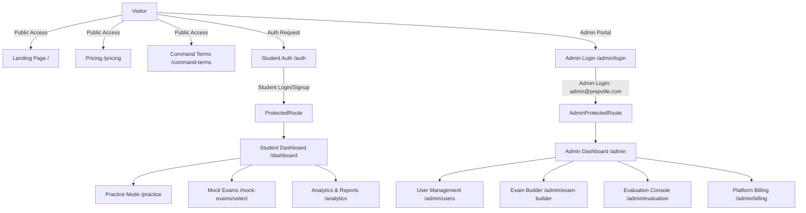

# 📚 PrepVille Learning Hub — Complete System Architecture & File Summary

This document provides a comprehensive overview of all **pages, components, utilities, database setup, security models, and system workflows** in the **PrepVille Learning Hub** codebase.

---

## 🎯 Executive Summary

**PrepVille Learning Hub** is a full-stack, enterprise-grade AI-powered learning and evaluation platform built for students and educators. It combines interactive question banks, timed mock exams, AI-assisted grading, study group collaboration, gamified XP progress tracking, and an extensive administrator control suite.

### Tech Stack Overview
- **Frontend Framework:** React + Vite + TypeScript
- **Styling:** Tailwind CSS + Lucide React + Radix UI / Shadcn UI components
- **Routing:** React Router v6 (`BrowserRouter`)
- **State Management & Querying:** React Query (`@tanstack/react-query`) + Custom React Contexts
- **Backend & Database:** Supabase (PostgreSQL, Row Level Security, Auth, Storage)
- **Role & Token Security:** Custom JWT claims (`app_metadata.role`), RLS Policies, and Protected Routes

---

## 🗺️ Application Routing & Workflow Architecture



---

## 📄 Complete Pages Catalog (`src/pages/`)

### 1. 🌐 Public & Authentication Pages
| Page File | Route | Description |
| :--- | :--- | :--- |
| [Index.tsx](file:///c:/Users/Rishi/OneDrive/Documents/GitHub/prepville-learning-hub/src/pages/Index.tsx) | `/` | Main public landing page featuring hero section, feature cards, live quick-practice demo, and pricing plans. |
| [Auth.tsx](file:///c:/Users/Rishi/OneDrive/Documents/GitHub/prepville-learning-hub/src/pages/Auth.tsx) | `/auth` | Student authentication portal supporting Email/Password, Google OAuth, and Demo Student access. |
| [AdminLogin.tsx](file:///c:/Users/Rishi/OneDrive/Documents/GitHub/prepville-learning-hub/src/pages/AdminLogin.tsx) | `/admin/login` | **Redesigned Admin Login Portal** featuring modern SaaS blue/purple gradients, quick practice preview, and role authentication. |
| [CommandTerms.tsx](file:///c:/Users/Rishi/OneDrive/Documents/GitHub/prepville-learning-hub/src/pages/CommandTerms.tsx) | `/command-terms` | Educational definitions and IB/Exam command terms reference library. |
| [Pricing.tsx](file:///c:/Users/Rishi/OneDrive/Documents/GitHub/prepville-learning-hub/src/pages/Pricing.tsx) | `/pricing` | Tiered subscription pricing plans and feature comparison matrix. |
| [Onboarding.tsx](file:///c:/Users/Rishi/OneDrive/Documents/GitHub/prepville-learning-hub/src/pages/Onboarding.tsx) | `/onboarding` | Multi-step student profile setup, grade/curriculum selection, and goal setting. |
| [NotFound.tsx](file:///c:/Users/Rishi/OneDrive/Documents/GitHub/prepville-learning-hub/src/pages/NotFound.tsx) | `*` | Custom 404 error page. |

---

### 2. 🎓 Student Learning & Exam Pages
| Page File | Route | Description |
| :--- | :--- | :--- |
| [StudentDashboard.tsx](file:///c:/Users/Rishi/OneDrive/Documents/GitHub/prepville-learning-hub/src/pages/StudentDashboard.tsx) | `/dashboard` | Main student hub showing daily goals, active assignments, streak tracker, and study shortcuts. |
| [Practice.tsx](file:///c:/Users/Rishi/OneDrive/Documents/GitHub/prepville-learning-hub/src/pages/Practice.tsx) | `/practice` | Categorized question bank browser filtered by subject, difficulty, and topic. |
| [PracticeQuestionView.tsx](file:///c:/Users/Rishi/OneDrive/Documents/GitHub/prepville-learning-hub/src/pages/PracticeQuestionView.tsx) | `/practice/question/:questionId` | Interactive question solver with step-by-step hints, AI feedback, and solution verification. |
| [QuickPractice.tsx](file:///c:/Users/Rishi/OneDrive/Documents/GitHub/prepville-learning-hub/src/pages/QuickPractice.tsx) | `/quick-practice` | Rapid 5-minute drill session generator. |
| [Quiz.tsx](file:///c:/Users/Rishi/OneDrive/Documents/GitHub/prepville-learning-hub/src/pages/Quiz.tsx) | `/quiz/:quizId` | Interactive quiz interface with real-time scoring. |
| [MockExamSelect.tsx](file:///c:/Users/Rishi/OneDrive/Documents/GitHub/prepville-learning-hub/src/pages/MockExamSelect.tsx) | `/mock-exams/select` | Selection portal for full-length timed mock exams. |
| [MockExamSubjectView.tsx](file:///c:/Users/Rishi/OneDrive/Documents/GitHub/prepville-learning-hub/src/pages/MockExamSubjectView.tsx) | `/mock-exams/subject/:subject` | Subject-filtered mock exam directory. |
| [MockExamStart.tsx](file:///c:/Users/Rishi/OneDrive/Documents/GitHub/prepville-learning-hub/src/pages/MockExamStart.tsx) | `/mock-exams/start` | Pre-exam instructions, countdown timer, and hardware check. |
| [UnifiedMockExam.tsx](file:///c:/Users/Rishi/OneDrive/Documents/GitHub/prepville-learning-hub/src/pages/UnifiedMockExam.tsx) | `/mock-exams/unified/:testId` | Full exam environment with auto-save, formula reference, and timer. |
| [ExamSubmitted.tsx](file:///c:/Users/Rishi/OneDrive/Documents/GitHub/prepville-learning-hub/src/pages/ExamSubmitted.tsx) | `/mock-exams/submitted` | Post-exam confirmation and submission status page. |
| [StudentExamResults.tsx](file:///c:/Users/Rishi/OneDrive/Documents/GitHub/prepville-learning-hub/src/pages/StudentExamResults.tsx) | `/mock-exams/results/:attemptId` | Comprehensive exam score report, solution key, and performance breakdown. |
| [StudentAssignments.tsx](file:///c:/Users/Rishi/OneDrive/Documents/GitHub/prepville-learning-hub/src/pages/StudentAssignments.tsx) | `/assignments` | Student assignment tracker with due dates and submission portals. |
| [Subjects.tsx](file:///c:/Users/Rishi/OneDrive/Documents/GitHub/prepville-learning-hub/src/pages/Subjects.tsx) | `/subjects` | Subject syllabus directory (Mathematics, Physics, Chemistry, Biology, etc.). |
| [SubjectLearning.tsx](file:///c:/Users/Rishi/OneDrive/Documents/GitHub/prepville-learning-hub/src/pages/SubjectLearning.tsx) | `/subject-learning` | Module-by-module learning path with video lessons and topic quizzes. |
| [Videos.tsx](file:///c:/Users/Rishi/OneDrive/Documents/GitHub/prepville-learning-hub/src/pages/Videos.tsx) | `/videos` | Video lesson streaming library. |
| [StudyMaterials.tsx](file:///c:/Users/Rishi/OneDrive/Documents/GitHub/prepville-learning-hub/src/pages/StudyMaterials.tsx) | `/study-materials` | Revision guides, formula sheets, and PDF document repository. |
| [StudyMaterialReader.tsx](file:///c:/Users/Rishi/OneDrive/Documents/GitHub/prepville-learning-hub/src/pages/StudyMaterialReader.tsx) | `/study-materials/read/:id` | Dedicated document viewer with bookmarking and notes. |
| [Analytics.tsx](file:///c:/Users/Rishi/OneDrive/Documents/GitHub/prepville-learning-hub/src/pages/Analytics.tsx) | `/analytics` | Detailed accuracy charts, weak area identification, and study time metrics. |

---

### 3. 🛠️ Utilities & Gamification Pages
| Page File | Route | Description |
| :--- | :--- | :--- |
| [StudyGroups.tsx](file:///c:/Users/Rishi/OneDrive/Documents/GitHub/prepville-learning-hub/src/pages/StudyGroups.tsx) | `/study-groups` | Peer study rooms, group messaging, and collaborative problem solving. |
| [GraphingTool.tsx](file:///c:/Users/Rishi/OneDrive/Documents/GitHub/prepville-learning-hub/src/pages/GraphingTool.tsx) | `/graphing-tool` | Interactive mathematical function plotting & graphing tool. |
| [FormulaHelper.tsx](file:///c:/Users/Rishi/OneDrive/Documents/GitHub/prepville-learning-hub/src/pages/FormulaHelper.tsx) | `/formula-helper` | Searchable math and science formula cheat sheet. |
| [TimedChallenge.tsx](file:///c:/Users/Rishi/OneDrive/Documents/GitHub/prepville-learning-hub/src/pages/TimedChallenge.tsx) | `/timed-challenge` | Speed challenge mode for rapid problem solving. |
| [Leaderboard.tsx](file:///c:/Users/Rishi/OneDrive/Documents/GitHub/prepville-learning-hub/src/pages/Leaderboard.tsx) | `/leaderboard` | Student XP rankings, weekly badges, and competitive leaderboards. |
| [LevelDetails.tsx](file:///c:/Users/Rishi/OneDrive/Documents/GitHub/prepville-learning-hub/src/pages/LevelDetails.tsx) | `/level-details` | Student XP level progression roadmap and unlockable rewards. |
| [Subscription.tsx](file:///c:/Users/Rishi/OneDrive/Documents/GitHub/prepville-learning-hub/src/pages/Subscription.tsx) | `/subscription` | Active plan details, billing renewal, and tier upgrades. |
| [Notifications.tsx](file:///c:/Users/Rishi/OneDrive/Documents/GitHub/prepville-learning-hub/src/pages/Notifications.tsx) | `/notifications` | User system notifications and assignment alerts. |

---

### 4. 👑 Administrator Console Pages (`src/pages/Admin*.tsx`)
| Page File | Route | Description |
| :--- | :--- | :--- |
| [AdminDashboard.tsx](file:///c:/Users/Rishi/OneDrive/Documents/GitHub/prepville-learning-hub/src/pages/AdminDashboard.tsx) | `/admin` | Main administrator command center with overview metrics and quick action tabs. |
| [AdminUsers.tsx](file:///c:/Users/Rishi/OneDrive/Documents/GitHub/prepville-learning-hub/src/pages/AdminUsers.tsx) | `/admin/users` | User account management, role assignment, and access control. |
| [AdminAssignments.tsx](file:///c:/Users/Rishi/OneDrive/Documents/GitHub/prepville-learning-hub/src/pages/AdminAssignments.tsx) | `/admin/assignments` | Assignment creation, class dispatch, and student submission tracking. |
| [AdminStudentsProgress.tsx](file:///c:/Users/Rishi/OneDrive/Documents/GitHub/prepville-learning-hub/src/pages/AdminStudentsProgress.tsx) | `/admin/students-progress` | Batch progress tracking across schools, cohorts, and subjects. |
| [AdminEvaluation.tsx](file:///c:/Users/Rishi/OneDrive/Documents/GitHub/prepville-learning-hub/src/pages/AdminEvaluation.tsx) | `/admin/evaluation` | AI-assisted and manual exam answer script evaluation interface. |
| [AdminTests.tsx](file:///c:/Users/Rishi/OneDrive/Documents/GitHub/prepville-learning-hub/src/pages/AdminTests.tsx) | `/admin/tests` | Overall test catalog management. |
| [AdminExamBuilder.tsx](file:///c:/Users/Rishi/OneDrive/Documents/GitHub/prepville-learning-hub/src/pages/AdminExamBuilder.tsx) | `/admin/exam-builder` | Full exam builder tool for multi-part exam creation. |
| [AdminQuestions.tsx](file:///c:/Users/Rishi/OneDrive/Documents/GitHub/prepville-learning-hub/src/pages/AdminQuestions.tsx) | `/admin/questions` | Centralized question bank manager with LaTeX formula and diagram support. |
| [AdminPracticeCreate.tsx](file:///c:/Users/Rishi/OneDrive/Documents/GitHub/prepville-learning-hub/src/pages/AdminPracticeCreate.tsx) | `/admin/practice/create` | Builder for targeted practice question sets. |
| [AdminMockTests.tsx](file:///c:/Users/Rishi/OneDrive/Documents/GitHub/prepville-learning-hub/src/pages/AdminMockTests.tsx) | `/admin/mock-tests` | Mock test repository. |
| [AdminMockTestCreate.tsx](file:///c:/Users/Rishi/OneDrive/Documents/GitHub/prepville-learning-hub/src/pages/AdminMockTestCreate.tsx) | `/admin/mock-tests/create` | Step-by-step mock exam creation wizard. |
| [AdminMockTestEdit.tsx](file:///c:/Users/Rishi/OneDrive/Documents/GitHub/prepville-learning-hub/src/pages/AdminMockTestEdit.tsx) | `/admin/mock-tests/edit/:id` | Editor for existing mock tests. |
| [AdminMockTestView.tsx](file:///c:/Users/Rishi/OneDrive/Documents/GitHub/prepville-learning-hub/src/pages/AdminMockTestView.tsx) | `/admin/mock-tests/view/:id` | Inspector view for published mock exams. |
| [AdminQuickTestCreate.tsx](file:///c:/Users/Rishi/OneDrive/Documents/GitHub/prepville-learning-hub/src/pages/AdminQuickTestCreate.tsx) | `/admin/quick-tests/create` | Quick diagnostic test generator. |
| [AdminStudyMaterials.tsx](file:///c:/Users/Rishi/OneDrive/Documents/GitHub/prepville-learning-hub/src/pages/AdminStudyMaterials.tsx) | `/admin/study-materials` | Study guide and reference document upload manager. |
| [AdminReports.tsx](file:///c:/Users/Rishi/OneDrive/Documents/GitHub/prepville-learning-hub/src/pages/AdminReports.tsx) | `/admin/reports` | System analytics and PDF report generation. |
| [AdminBilling.tsx](file:///c:/Users/Rishi/OneDrive/Documents/GitHub/prepville-learning-hub/src/pages/AdminBilling.tsx) | `/admin/billing` | Platform deployment cost, Vercel/Supabase plan, and AI credit wallet dashboard. |
| [AdminSettings.tsx](file:///c:/Users/Rishi/OneDrive/Documents/GitHub/prepville-learning-hub/src/pages/AdminSettings.tsx) | `/admin/settings` | Platform global settings and customization. |

---

## 🔒 Security, Auth & Database Integration

### 1. Authentication Service (`src/lib/authService.ts`)
- Manages Supabase Auth calls (`signInWithPassword`, `signUp`, `signInWithOAuth`).
- Handles **Offline Demo Sessions** (`createDemoSession`, `createDemoAdminSession`).
- Admin Default Credentials:
  - **Email:** `admin@prepville.com`
  - **Password:** `adminset`

### 2. Route Protection Wrappers
- **[ProtectedRoute.tsx](file:///c:/Users/Rishi/OneDrive/Documents/GitHub/prepville-learning-hub/src/components/ProtectedRoute.tsx):** Protects student routes, enforcing active authentication and subscription status.
- **[AdminProtectedRoute.tsx](file:///c:/Users/Rishi/OneDrive/Documents/GitHub/prepville-learning-hub/src/components/AdminProtectedRoute.tsx):** Restricts access to `/admin/*` routes to users with `role: 'admin'` or active Admin Demo sessions.

### 3. Supabase SQL & Role Setup (`supabase/admin_auth_setup.sql`)
The backend security is governed by custom PostgreSQL functions and triggers:
- `public.app_role` ENUM (`'admin'`, `'student'`, `'teacher'`)
- `public.has_role(user_id, role)` verification function
- `public.sync_user_jwt_admin_role()` trigger that automatically injects `raw_app_meta_data -> 'role'` into Supabase JWT tokens.
- Automatic RLS policy application across all base tables.
- `public.make_user_admin(email)` helper function.

---

## 🔄 Core User Workflows

### Workflow 1: Student Learning & Practice Flow
1. Student logs in at `/auth` or enters via demo session.
2. Selects a subject or question set from `/practice`.
3. Solves questions in `/practice/question/:questionId` with real-time AI hints and latex rendering.
4. XP is automatically recorded via `StreakAutoRecorder` and updated in `/leaderboard` and `/analytics`.

### Workflow 2: Timed Mock Exam Flow
1. Student browses available exams at `/mock-exams/select`.
2. Starts exam at `/mock-exams/start` (enforces full-screen and timer).
3. Answers questions in `/mock-exams/unified/:testId` with auto-save.
4. Submits exam and views instant score analysis at `/mock-exams/results/:attemptId`.

### Workflow 3: Administrator Workflow
1. Admin opens `http://localhost:8080/admin/login`.
2. Authenticates using `admin@prepville.com` / `adminset` (or Google OAuth / Demo Sign-In).
3. Accesses `/admin` dashboard.
4. Builds new exams via `/admin/exam-builder`, manages question banks in `/admin/questions`, and evaluates submissions at `/admin/evaluation`.

---

## 📂 File Architecture Tree

```
prepville-learning-hub/
├── public/
├── src/
│   ├── assets/                # Logos, illustrations & avatars
│   ├── components/            # Reusable UI components
│   │   ├── admin/             # 46+ Admin management components
│   │   ├── auth/              # Auth forms & headers
│   │   ├── mock-exam/         # Exam timer & question cards
│   │   └── ui/                # Shadcn UI primitives (Button, Input, Card, Tabs...)
│   ├── contexts/              # Chatbot and app contexts
│   ├── data/                  # Static subject & question bank data
│   ├── hooks/                 # Custom React hooks (useAuth, useSubscription, etc.)
│   ├── integrations/
│   │   └── supabase/          # Supabase client & auto-generated types
│   ├── lib/                   # Auth service & utility functions
│   ├── pages/                 # 55+ Page components (Admin & Student)
│   ├── services/              # PDF report generator & external APIs
│   ├── types/                 # TypeScript type definitions
│   ├── App.tsx                # Central Router setup
│   └── main.tsx               # Entry point
├── supabase/
│   ├── admin_auth_setup.sql   # Admin JWT & RLS SQL configuration
│   └── migrations/            # 80+ Database migration scripts
├── summarize.md               # Codebase documentation summary
├── package.json
└── tailwind.config.ts
```
